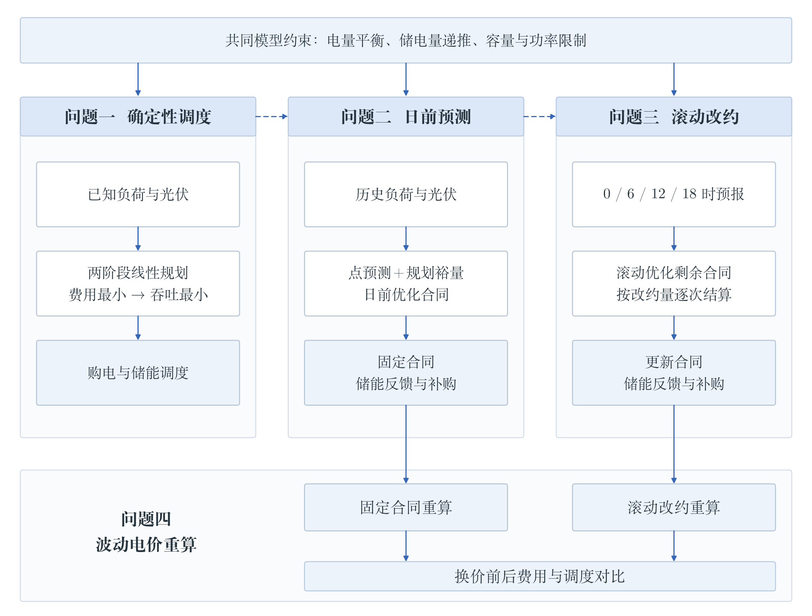
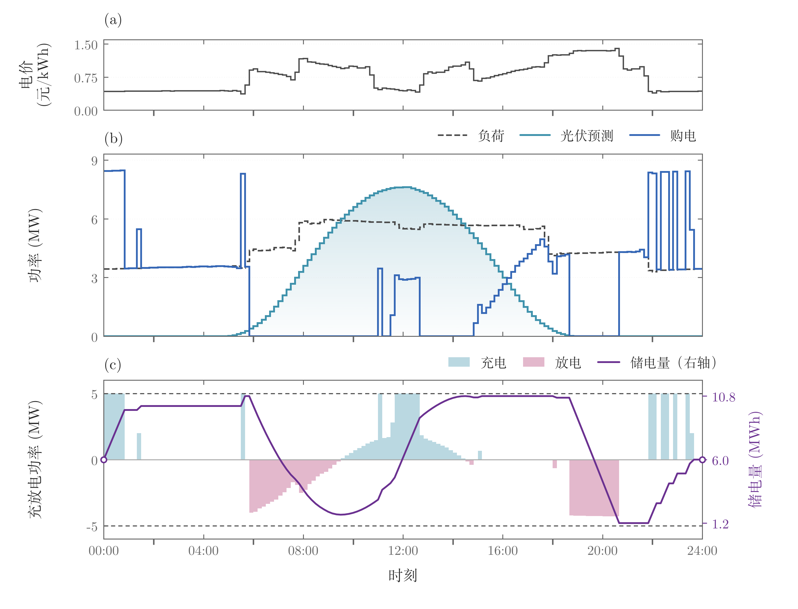
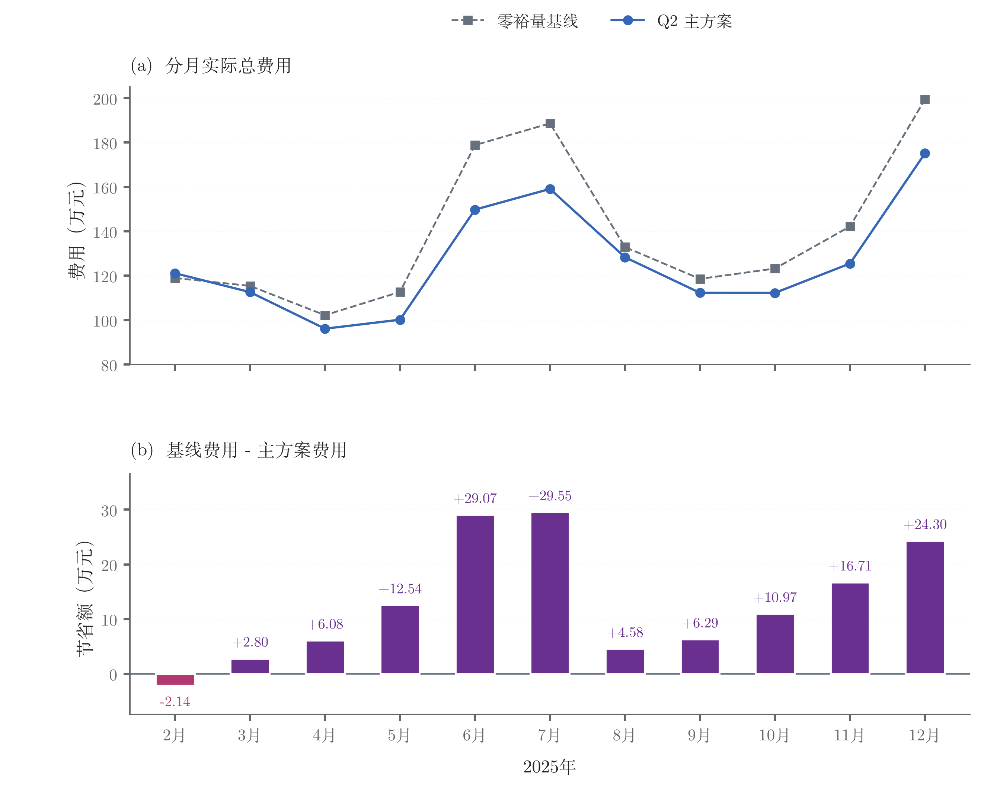
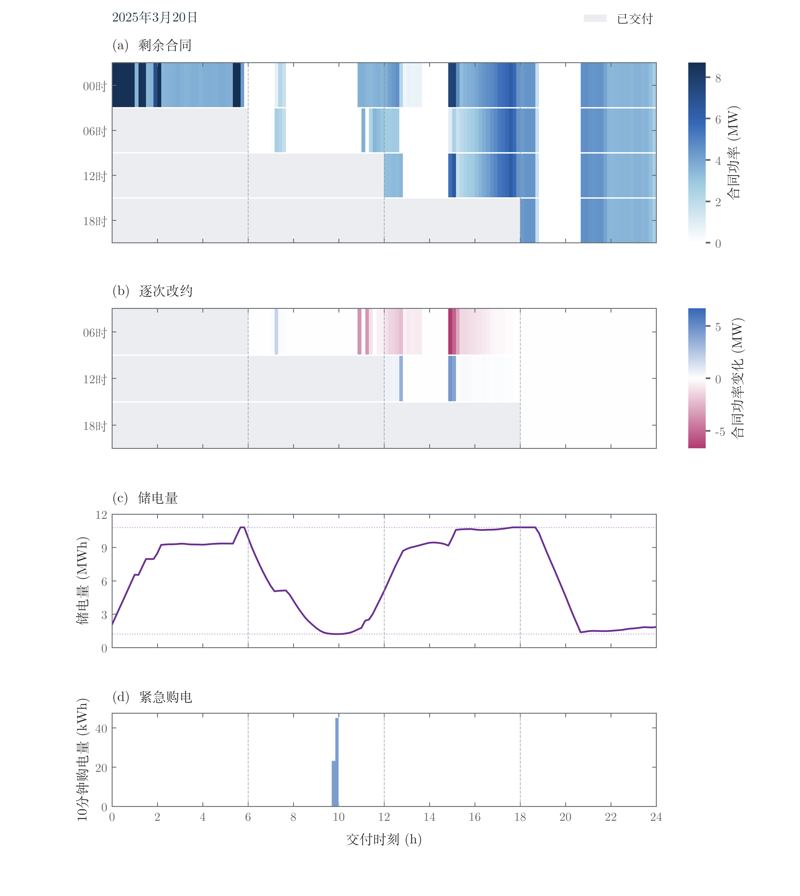
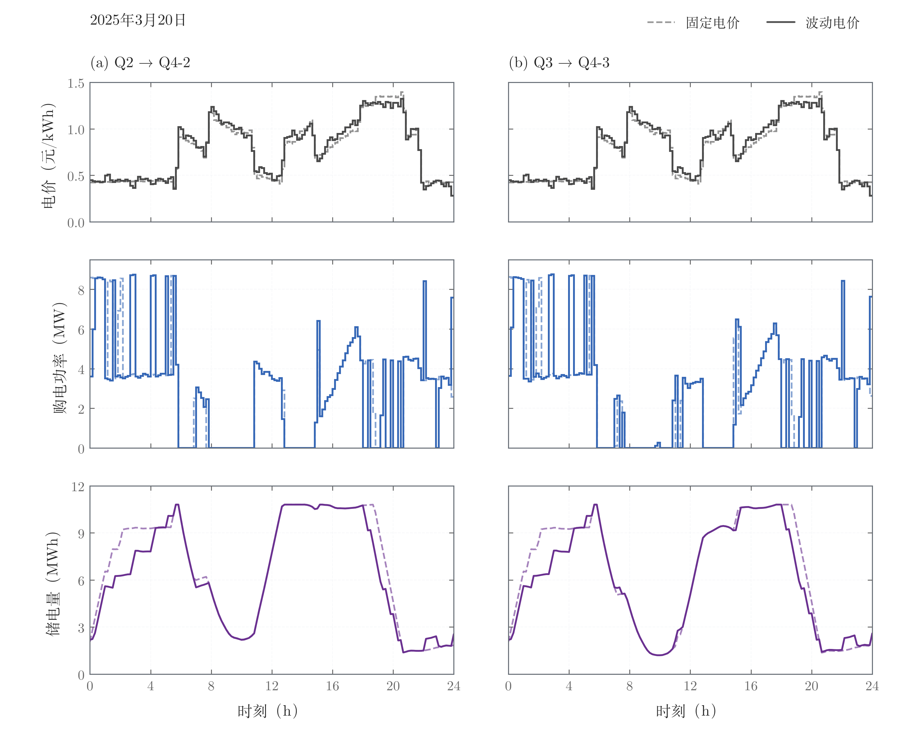

# 基于两级线性规划与滚动调整的微网购电及储能调度

> 数学建模竞赛论文与完整可复现代码。光伏出力与用电负荷在时间分布上存在差异，本文在供需变化与电价波动下
> 构建**两级线性规划 + 风险裕量 + 滚动调整 + 实时反馈**的微网调度框架，统一求解典型日优化、日初固定采购、
> 日内滚动改约与波动电价四类决策场景。

[](https://github.com/lyrawinslet/microgrid-storage-dispatch/actions/workflows/verify.yml)


**关键交付物**：[论文全文（28 页 + 附录）](docs/论文_正文28页_图12拆分修正版.pdf) ·
[五份结果工作簿](#三结果速览) · [交互式分析页面](dashboard/CUMCM_lab.html) ·
[数据与结果说明](docs/数据与结果说明.md)

---

## 目录

- [一、问题背景与建模框架](#一问题背景与建模框架)
- [二、四个问题的数学模型](#二四个问题的数学模型)
- [三、结果速览](#三结果速览)
- [四、模型检验](#四模型检验)
- [五、仓库结构](#五仓库结构)
- [六、快速开始](#六快速开始)
- [七、复现环境与关键参数](#七复现环境与关键参数)
- [八、模型评价、改进与推广](#八模型评价改进与推广)
- [九、声明与致谢](#九声明与致谢)

---

## 一、问题背景与建模框架

微网由分布式电源与用电负荷组成，与外网相连：电价较低或光伏富余时储能，电价较高时放电，从而在满足用电
需求的前提下降低购电费用。储能的调节能力受**容量、充放电功率与效率**限制，因此需要结合供需变化与实际
储电量，联合决策外网购电与储能充放电。

四问共用**电量平衡**与**储能运行**约束，并随"可用信息"与"合同调整权限"的变化扩展决策变量：

| 问题 | 可得信息 | 采购权限 | 决策特征 |
| --- | --- | --- | --- |
| 问题一 | 典型日负荷、光伏预测、分时电价（已知） | 日初一次确定全天 | 确定性优化，日末储电量回归日初 |
| 问题二 | 历史实测负荷/光伏 + 固定分时电价 | 日初确定合同量，全天不可改 | 先规划（含风险裕量）后实时反馈 |
| 问题三 | 每日 0/6/12/18 时发布的光伏预报 | 可在预报更新时改约，逐次结算 | 滚动优化 + 增购/减购费用 |
| 问题四 | 目标日各时段**波动电价**已知 | 分别沿用问题二、问题三权限 | Q4-2 固定合同 / Q4-3 滚动调整 |



**核心求解思想——两级线性规划**：第一级以购电费用最小为目标求解 LP；第二级在费用容差
$\varepsilon_C=10^{-6}$ 元内，最小化规划充放电总量 $\sum_t(\tilde c_t+\tilde r_t)$。论文证明在允许
**无成本弃置**的条件下，第二级最优解自动满足互斥条件 $c_t r_t=0$（若同时充放电，可令
$a=\min\{c_t,\ r_t/(\eta_c\eta_d)\}$ 并按 $r_t'=r_t-\eta_c\eta_d a$ 修正，递推、平衡与费用均不变而
充放电总量严格下降），因此无需引入整数变量，全部模型保持线性、可用 HiGHS 高效求解。

---

## 二、四个问题的数学模型

### 2.1 问题一：典型日确定性的购电—储能联合调度

时段 $t=1,\dots,144$（$\Delta t=1/6$ h），决策变量为购电量 $q_t$、充电量 $c_t$、放电量 $r_t$、
未利用电量 $w_t$ 与时段末储电量 $S_t$。

$$
\min_{q,c,r,w,S}\ C_1=\sum_{t=1}^{144} p_t q_t
$$

$$
\begin{aligned}
&\text{电量平衡} && q_t+r_t=n_t+c_t+w_t,\qquad n_t=(L_t-\hat G_t)\Delta t\\
&\text{储电量递推} && S_t=S_{t-1}+\eta_c c_t-\frac{r_t}{\eta_d}\\
&\text{容量约束} && 1200\le S_t\le 10800\\
&\text{功率约束} && 0\le c_t,\ r_t\le U=5000/6\\
&\text{非负与互斥} && q_t,w_t\ge0,\qquad c_t r_t=0\\
&\text{日末回归} && S_0=S_{144}=6000
\end{aligned}
$$

模型规模：**720 个变量、289 个等式约束**。

### 2.2 问题二：日初固定合同 + 风险裕量 + 储能实时反馈

**指数加权预测**（负荷取前 28 天中相同星期几的样本，权重随时间衰减；光伏取最近 7 天）：

$$
\hat L_{D,t}=\frac{\sum_{j\in\mathcal H_D}\omega_{D,j}L_{j,t}}{\sum_{j\in\mathcal H_D}\omega_{D,j}},
\quad \omega_{D,j}=e^{-(D-j)/7},
\qquad
\hat G_{D,t}=\max\Big\{0,\ \frac{\sum_{j\in\mathcal P_D}\omega_{D,j}G_{j,t}}{\sum_{j\in\mathcal P_D}\omega_{D,j}}\Big\}
$$

**经验分位数风险裕量**：把一天划分为 6 个四小时组，汇集目标日前最多 28 天同组预测误差
$\epsilon_{j,t}=n_{j,t}-\hat n_{j,t}$，取 80% 线性插值分位数作为裕量（历史不足 7 天时裕量为 0）：

$$
b_{D,t}=\max\{0,\ Q_{0.8}(\mathcal E_{D,g(t)})\},\qquad \tilde n_{D,t}=\hat n_{D,t}+b_{D,t}
$$

**规划阶段**（合同量 $q_{D,t}$ 全天固定）：

$$
\min\ \tilde J_D=\sum_{t=1}^{144}p_t q_{D,t}-v_D\tilde S_{D,144},
\qquad v_D=\gamma\,\eta_d\,\mathrm{median}_t(p_t),\quad \gamma=0.5
$$

约束为 2.1 中的平衡、递推、容量与功率约束（净需求替换为 $\tilde n_{D,t}$），但**不要求日末等于日初**，
以日末价值项近似跨日收益。

**执行阶段**（按实际供需实时反馈，净缺口 $z_{D,t}=n_{D,t}-q_{D,t}$）：

$$
c_{D,t}=\min\big\{[-z_{D,t}]^+,\ U,\ (10800-S_{D,t-1})/\eta_c\big\},\qquad
r_{D,t}=\min\big\{[z_{D,t}]^+,\ U,\ \eta_d(S_{D,t-1}-1200)\big\}
$$

$$
e_{D,t}=[z_{D,t}-r_{D,t}]^+,\qquad w_{D,t}=[-z_{D,t}-c_{D,t}]^+,\qquad
S_{D,t}=S_{D,t-1}+\eta_c c_{D,t}-\frac{r_{D,t}}{\eta_d}
$$

费用口径（紧急购电按交易时刻电价的 **5 倍**计价）：

$$
C_2=\sum_{D\in\mathcal D}\sum_{t=1}^{144}\big(p_t q_{D,t}+5p_t e_{D,t}\big)
$$

评价期为 **2025-02-01 — 12-31，共 334 天 / 48,096 个时段**（1 月为初始化期，不计费用）。

### 2.3 问题三：日内分时预报 + 滚动改约 + 逐次结算

预报按发布时点 $k\in\{0,6,12,18\}$ 与提前时长插值得到 $\hat G_{D,t|k}$；风险裕量按**目标时段 × 提前
时长**四档（$(0,6],(6,12],(12,18],(18,24]$）分组取分位数，主方案 $\alpha=0.8$。

**合同调整费用**（$\bar y$ 为本次调整前的约定量，$y$ 为调整后）：

$$
a^+_{D,k,t}=[y_{D,t|k}-\bar y_{D,t|k}]^+,\quad
a^-_{D,k,t}=[\bar y_{D,t|k}-y_{D,t|k}]^+,\quad
h_{D,k,t}=1.5\,p_t a^+_{D,k,t}-0.5\,p_t a^-_{D,k,t}
$$

即**增购付 1.5 倍电价、减购净退 0.5 倍电价**，已交付未利用电量不退款；每次调整后以新合同量作为下次基准。
示例：电价 1 元/kWh、合同 100 → 80 → 100 kWh，累计费用 $100-0.5\times20+1.5\times20=120$ 元。

**日内滚动模型**（$R_k=\{m_k+1,\dots,144\}$ 为剩余时段，$m_k=6k$）：

$$
\min\ \tilde J_{D,k}=\sum_{t\in R_k}\big(1.5p_t a^+_t-0.5p_t a^-_t+5p_t\tilde e_t\big)-\lambda_D(\tilde S_{144}-1200)
$$

$$
y_t+\tilde r_t+\tilde e_t=\tilde n_{D,t|k}+\tilde c_t+\tilde w_t,\qquad
y_t-a^+_t+a^-_t=\bar y_t,\qquad
\tilde S_t=\tilde S_{t-1}+\eta_c\tilde c_t-\frac{\tilde r_t}{\eta_d},\qquad
\tilde S_{m_k}=S_{D,m_k}
$$

日初 0 时模型为 720 变量 / 288 等式，6 时规划为 864 变量 / 324 等式；执行阶段仍按 2.2 的实时反馈规则
每 10 分钟调节，只需把固定合同量换成当前约定量。已支付费用不重复计入当前目标。

$$
C_3=\sum_{D}\Big[\sum_t p_t q_{D,t}+\sum_{k\in\{6,12,18\}}\sum_{t\in R_k}h_{D,k,t}+\sum_t 5p_t e_{D,t}\Big]
$$

### 2.4 问题四：波动电价下的固定合同与滚动调整

把逐时段价格 $p_{D,t}$ 代入相应目标与结算公式，保留问题二/问题三的决策权限、预测规则、风险裕量与储能
控制不变：

$$
\tilde J^{(4\text{-}2)}_{D,0}=\sum_{t=1}^{144}p_{D,t}q_{D,t}-v_D\tilde S_{D,144},
\qquad
\tilde J^{(4\text{-}3)}_{D,k}=\sum_{t\in R_k}p_{D,t}\big(1.5a^+_{D,k,t}-0.5a^-_{D,k,t}+5\tilde e_{D,t|k}\big)-\lambda_D(\tilde S_{D,144}-1200)
$$

> 信息条件说明：代码中 `FORMAL_PRICE_INFORMATION` 明确声明——为完成题目给定数据下的离线重算，把附件 4
> 目标日完整价格路径视为规划输入；这不代表现实运行中可提前获得未来实时电价，相应的结果需在该信息条件下评价。

---

## 三、结果速览

`python run.py --task verify` 会从原始附件出发，**仅用标准库**重算电量、储能状态与费用并与五份工作簿逐格
比对：**701,026 项数值核对通过，最大绝对差异 2.24e-08**。

| 输出文件 | 场景 | 总购电费用（元） | 对照方案 | 降幅 | 紧急购电量 |
| --- | --- | ---: | --- | ---: | ---: |
| `result1.xlsx` | 问题一 典型日 | **35,126.95** | 无储能 48,052.05 | −26.90% | — |
| `result2.xlsx` | 问题二 固定合同 | **13,923,903.39** | 零裕量 15,331,204.79 | −9.18% | 111,928.38 kWh（−79.45%） |
| `result3.xlsx` | 问题三 滚动调整 | **13,833,843.32** | 零裕量 13,931,811.69 / 仅 0 时预报 14,109,764.92 | −0.70% / −1.96% | 51,525.70 kWh（−73.18%） |
| `result4-2.xlsx` | 问题四 固定合同 | **14,571,629.31** | 零裕量 16,126,251.22 | −9.64% | 114,255.22 kWh（−79.71%） |
| `result4-3.xlsx` | 问题四 滚动调整 | **14,487,237.24** | 零裕量 14,630,561.99 | −0.98% | 56,367.66 kWh（−73.30%） |

**主要结论**

1. **储能的价值来自时序转移而非减少购电量。** 问题一费用降幅 26.90% 远大于购电量降幅 3.73%：储能吸收
   6,247.96 kWh 富余光伏，并把高价时段需求转移到低价时段（放电量为充电量的 0.81 倍，损耗 3,940.73 kWh）。
2. **风险裕量以"更多正常采购"换取"更少高价补购"。** 问题二合同购电费增加 1,112,028.68 元，紧急购电费
   减少 2,519,330.08 元，净省 1,407,301.40 元；两方案预测精度完全相同（净负荷 MAE 43.97 kWh/时段），
   说明节费来自采购安排与储能运行，而非预测更准。
3. **滚动改约的收益集中在午间新增预报。** 四时点方案比仅 0 时方案节省 275,921.60 元（1.96%），其中新增
   12 时调整机会的贡献最大；改约可能"净减购却净支出"，结算必须逐时段、逐次计费。
4. **预测更准 ≠ 费用更低。** 官方光伏预报使净负荷 MAE 由 43.97 降至 34.54 kWh/时段，但其合同购电与调整
   费用高 27.49 万元、紧急购电费仅低 2.70 万元，总费用反而高 24.79 万元。

| 问题一：典型日电价、购电与储能 | 问题二：分月费用与节省额 |
| --- | --- |
|  |  |

| 问题三：滚动改约与储能运行 | 问题四：固定/波动电价典型日对比 |
| --- | --- |
|  |  |

其余论文插图见 [`figures/`](figures/)，逐图说明见[数据与结果说明](docs/数据与结果说明.md#7-图目录figures)。

---

## 四、模型检验

| 检验 | 做法 | 结论 |
| --- | --- | --- |
| 结果核对 | `run.py --task verify` 从附件重算 48,096 时段费用与储能状态 | 701,026 项核对通过，最大绝对差异 2.24e-08 |
| 预测精度 | 与同期延续、等权均值基准比较（表 6-6） | 本文净负荷 MAE 43.97，较两基准降 13.16% / 7.39% |
| 参数敏感性 | 储能效率（85%/95%）、容量（9,600/14,400 kWh）、功率（4,000/6,000 kW） | 容量与效率影响大于功率，费用变化介于 −3.57% ~ +4.50% |
| 初始储电量 | 统一评价期起点（6,000 / 2,475 kWh）后重算 | 两种起点均节费 9.18%，与原连续运行相差 < 0.04% |
| 风险裕量覆盖 | 统计实际超越比例（表 7-6） | Q2 覆盖率 78.82%、Q3 77.35%，略低于 80% 名义水平 |
| 储能控制对照 | 价格感知预留策略 vs 原实时反馈（表 7-7） | 预留策略费用反而增加 0.76%，故沿用实时反馈 |
| 电价替换一致性 | `verify_inheritance.py`、`q4_robustness_summary.json` | 各策略内部统一期初储电量后，降费方向保持一致 |

---

## 五、仓库结构

```
microgrid-storage-dispatch/
├── README.md                     # 本文件：问题、模型、结果、复现说明
├── LICENSE                       # MIT（代码）
├── requirements.txt              # numpy/scipy/pandas/openpyxl 固定版本
├── run.py                        # 跨平台统一运行入口（命令行 + 交互菜单）
├── start_windows.bat             # Windows 双击启动
├── start_mac.command             # macOS 启动
├── result1.xlsx … result4-3.xlsx # 五份提交结果（同时是导出格式基准）
├── code/                         # 四问模型、预测、导出与核对程序
├── data/                         # 附件1–4：原始电价、负荷、光伏与预报数据
├── comparison/                   # 对照表、检验结果、主方案逐时段记录
├── experiments/                  # 预测基准与储能预留两项补充实验
├── dashboard/CUMCM_lab.html      # 交互式调度结果分析页面（浏览器打开）
├── docs/                         # 论文全文、AI 工具使用详情、数据与结果说明
├── figures/                      # 论文插图（图1–图15，按图号导出）
└── .github/workflows/verify.yml  # CI：每次推送自动核对五份结果
```

每个文件/目录的逐项说明见 [`docs/数据与结果说明.md`](docs/数据与结果说明.md)（对应论文附录 A 表 A-1）。

---

## 六、快速开始

需要 **64 位 Python 3.11 / 3.12 / 3.13**（论文结果在 3.12 上复现）。Windows 可直接双击
`start_windows.bat`，macOS 运行 `bash start_mac.command`，或使用统一命令行入口：

| 命令 | 作用 | 是否需要第三方依赖 |
| --- | --- | --- |
| `python run.py --task verify` | 核对随仓库提交的五份结果（701,026 项数值检查） | 否，仅标准库 |
| `python run.py --setup` | 在仓库内创建 `.venv` 并安装固定版本依赖（首次需联网） | — |
| `python run.py --task all` | 重算四问主方案及对应基准，导出五份 Excel | 是 |
| `python run.py --task full` | 在 `all` 基础上复现预报时点、参数、机制与 Q4 检验 | 是 |
| `python run.py --task q1`（`q2`/`q3`/`q4`） | 只重算指定问题 | 是 |
| `python run.py --task supplement` | 重算两项补充实验并独立核验 | 是 |

```powershell
# Windows 示例：先核对已提交结果，再完整复现
git clone https://github.com/lyrawinslet/microgrid-storage-dispatch.git
cd microgrid-storage-dispatch
python run.py --task verify          # 秒级完成，无需安装依赖
python run.py --setup                # 创建 .venv 并安装固定版本依赖
python run.py --task full            # 全量重算，输出到 rerun/<时间戳>/
```

> 重算结果一律写入新建的 `rerun/<时间戳>/` 目录，**永远不会覆盖**根目录下五份提交结果；
> `--output` 可指定其他尚不存在的输出目录。核对脚本 `code/verify_results.py` 只重算电量、储能状态与
> 费用，不重新求解优化模型。

---

## 七、复现环境与关键参数

| 类别 | 设定 |
| --- | --- |
| 运行环境 | 64 位 Python 3.11–3.13；`PYTHONUTF8=1`；数值库线程数固定为 1 |
| 依赖版本 | `numpy==2.3.5`、`scipy==1.17.0`、`pandas==2.2.3`、`openpyxl==3.1.5` |
| 求解器 | `scipy.optimize.linprog(method="highs")`（HiGHS），两级 LP 容差 $10^{-6}$ 元 |
| 时段粒度 | $\Delta t=1/6$ h，144 时段/日，145 个储电状态 |
| 储能参数 | 额定容量 12,000 kWh，储电量限值 1,200 / 10,800 kWh，交流侧充放功率上限 5,000 kW（$U=5000/6$ kWh/时段），$\eta_c=\eta_d=0.9$ |
| 评价期 | 2025-02-01 — 12-31，共 334 天 / 48,096 时段（2025-01-01 初值 6,000 kWh，1 月为初始化期） |
| 风险参数 | 经验分位数 $\alpha=0.8$（线性插值）；历史样本不足 7 天时裕量取 0；Q2 按 6 个四小时组分组，Q3 按目标时段 × 提前时长 4 档分组 |
| 日末价值 | $v_D=\lambda_D=\gamma\eta_d\,\mathrm{median}_t(p_t)$，$\gamma=0.5$，12-31 取零 |
| 结算规则 | 紧急购电 5 倍交易时刻电价；增购 1.5 倍、减购净退 0.5 倍正常电价；已交付未利用电量不退款 |
| 预测规则 | 负荷：前 28 天相同星期几、权重 $e^{-\text{age}/7}$；光伏：最近 7 天加权；预报插值：按提前时长线性插值 |

---

## 八、模型评价、改进与推广

**优点**：①购电规划与实际运行衔接——合同量由预测与风险裕量确定，充放电按实际供需实时调节，逐日传递
实际储电量；②两级 LP 在保留线性结构的同时消除无意义的充放电，无需整数变量；③结算反映每次改约成本，
保留同一交付时段多次调整的费用；④对照分析区分"预测精度"与"调度收益"，并保留部分月份/方案费用更高的
真实结论。

**不足**：①风险分位数固定，未与当日电价、储电量联合选择；②跨日价值与实时控制仍为近似（日末价值项概括
次日收益，未做多日联合优化）；③问题四假设目标日价格已知，未考虑电价预测误差；④目标未计电池循环衰减、
寿命消耗与投资成本，敏感性分析只反映运行费用。

**改进与推广**：在滚动历史窗口中比较不同分位数、以实际购电费用与紧急购电需求共同评价；延长规划范围，
把后续日期的可用预测纳入留电决策；在决策时点可得信息下预测电价、按实际交付价格计费；把循环衰减与寿命
成本纳入评价。框架可迁移到具备光伏、储能与外网购电条件的园区、校园微网，迁移时需重新核实储能参数、
预报发布时间、决策时点可得的电价信息与合同调整规则，并用当地历史数据校准预测与风险裕量。

---

## 九、声明与致谢

- 论文与结果由参赛队完成；代码中的求解、导出与核对脚本均随仓库提供，可端到端复现。
- 题目原始附件（`data/`）版权归竞赛主办方所有，仅用于学习与复现交流，请勿用于商业用途。
- 论文附录附有 **AI 使用声明**：AI 工具用于语言润色、代码调试、文献检索与交互网页搭建，全部输出均经
  人工核验，详见 [`docs/AI工具使用详情.pdf`](docs/AI工具使用详情.pdf)。
- 求解依赖 [SciPy](https://scipy.org/) 的 HiGHS 接口；数据读写依赖 pandas / openpyxl。
- 代码以 [MIT 许可证](LICENSE) 开源，欢迎在引用时注明出处。
